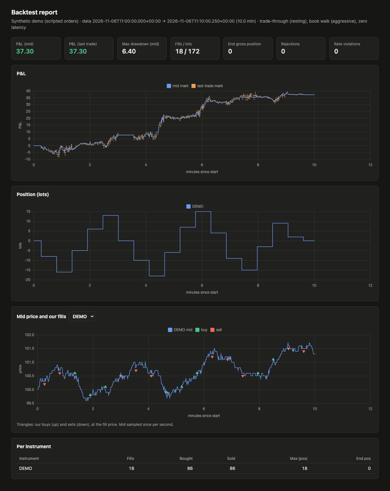

# Optiver x ETH Coding Challenge

A hackathon side project built during the Optiver x ETH trading challenge: a Python trading framework for Optibook, a simulated exchange, with swappable strategies, market-data recording, and an offline replay backtester.

The interesting engineering problem was closing the loop from research to execution under time pressure: collect data, test an idea, inspect its trades and inventory, and iterate without rewriting the bot around each strategy.

**Stack:** Python 3.11 · uv · pytest · CSV replay · HTML/Chart.js reports

## Our approach

I owned the code and trade execution. My teammates handled the trading strategy, data analysis, and backtesting.

We separated trading decisions from the mechanics of running a bot. A strategy receives market snapshots and account state and returns order intents. The shared runner handles market-data updates, fill tracking, risk clipping, order reconciliation, request pacing, and recording.

At a high level, we ran an adaptive relative-value / market-making strategy, combining passive quotes with selective aggressive execution and inventory hedging. We used recorded and historical market data to evaluate variants through the replay backtester. The instrument relationships, signal formulas, fitted parameters, and decision rules are deliberately withheld so future participants can do their own research.

The workflow was:

1. Record order books, public trades, our fills, order requests, positions, and P&L from the same bot process.
2. Replay data through the same decision, risk, and execution path against a simulated exchange.
3. Swap strategy modules to compare ideas while keeping the surrounding framework consistent.
4. Inspect P&L alongside drawdown, fills, rejections, request rates, and remaining inventory.

This repository documents the implementation and workflow; it does not publish a verified performance result or competition ranking.

## What is included

| Path | Purpose |
| --- | --- |
| `src/strategy.py` | Documented strategy interface with a no-order placeholder |
| `src/runner.py` | Shared polling loop for the event client and offline replay |
| `src/risk.py`, `src/orders.py` | Tick rounding, exposure checks, and order reconciliation |
| `src/recorder.py` | CSV recording for research and evaluation |
| `src/backtest/` | Data loading, simulated exchange, replay, and comparison reports |
| `tests/` | Offline checks using fake exchanges and synthetic data |
| `docs/` | Links to official Optibook documentation and a synthetic report preview |
| `references/` | Credited upstream source snapshots used for reference |

The actual competition strategy, its model helpers and revealing tests, and run logs/data are excluded from the public source tree. The remaining examples and tests demonstrate infrastructure with synthetic inputs rather than reproduce the competition solution. Generated recordings, learned state, and backtest reports stay under the git-ignored `runs/` directory.

## Swappable strategies

The plug-in contract is a single function:

```python
def decide(snapshots, states, now):
    # Return {instrument_id: [OrderIntent, ...]}.
    return {}
```

The result describes the desired resting orders plus any immediate-or-cancel orders for the current loop. Missing instruments or empty lists request cancellation of resting quotes; they do not liquidate inventory. Strategy modules own their state and must avoid repeatedly emitting an immediate order unintentionally. See [`src/strategy.py`](src/strategy.py) for the contract.

Backtests accept a separate strategy file via `--strategy`. The event entry point imports `src/strategy.py`; the public placeholder generates no new orders.

## Offline setup and checks

```bash
uv sync
uv run python -m compileall -q src
uv run pytest -q
```

The tests use fake exchanges and need no Optibook installation or credentials. The event client is available in the organiser's workspace; offline checks do not validate live trading behavior. No bot needs to be started to explore the code or run these checks.

## Backtesting

With your own data in the recorder's format (`books.csv`, optionally `trade_ticks.csv`) and your own strategy module:

```bash
uv run python src/backtest/run.py /path/to/data --strategy /path/to/my_strategy.py
uv run python src/backtest/report.py runs/backtests/A runs/backtests/B
```

Each replay produces equity, fill, and order CSVs, a JSON summary, a log, and an HTML report. The comparison report uses Chart.js from a CDN. No competition recordings or result reports are bundled.



*Demo using generated market data and scripted orders.*

The simulator assumes zero latency and no market impact. Aggressive orders walk recorded book depth; resting orders fill on a trade strictly through their price or a crossing book snapshot. Queue position and self-trades are not modelled, and recordings can contain the recording bot's own quotes. Request-limit violations are counted rather than simulated as disconnects. These assumptions make replay useful for comparing ideas, but simulated P&L is not proof of live performance.

## References and credits

- **Optiver and the ETH event organisers:** the challenge, Optibook exchange, API documentation, workspace guidance, and supplied example notebook. Official source links are listed in [`docs/`](docs/README.md). Event materials are credited to their original authors.
- **[beatzxbt/smm](https://github.com/beatzxbt/smm):** reference material for market-making structure, inventory management, and order management. Snapshot: `a9799babd88a62030097028e943f36013b5ba505`; copyright © 2023 beatzxbt, [MIT license](references/beatzxbt/smm/LICENSE).
- **[beatzxbt/mm-toolbox](https://github.com/beatzxbt/mm-toolbox):** reference implementations for order books, moving averages, rounding, and buffers. Snapshot: `201b01ca9d63f23b096355e20cb1e6126eda1c0e`; copyright © 2024 beatzxbt, [MIT license](references/beatzxbt/mm-toolbox/LICENSE).
- **[Chart.js](https://www.chartjs.org/):** charts in the generated backtest reports.

The upstream projects were used as study references, are retained with their licenses, and are not runtime dependencies. See [`references/README.md`](references/README.md) for snapshot provenance and notes. Credit to these projects does not imply endorsement or authorship of our competition strategy.
